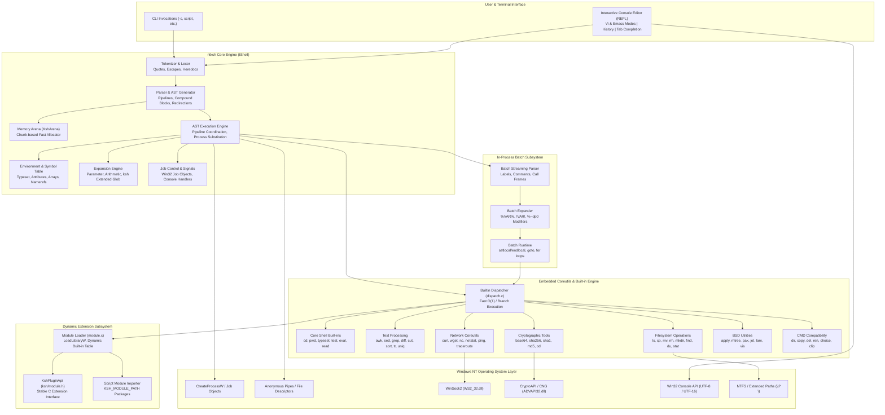

# ntksh — Architecture & Developer Guide

Welcome to the **ntksh (Windows NT KornShell & Embedded Coreutils)** Architecture and Developer Guide. This document provides a comprehensive technical reference for systems engineers, shell developers, and contributors seeking to understand the internal design, build system, subsystem boundaries, extension ABI, and implementation details of `ntksh`.

---

## Table of Contents

1. [Executive Summary & Architectural Philosophy](#1-executive-summary--architectural-philosophy)
   - [Mission & Key Tenets](#mission--key-tenets)
   - [Comparison with Other Windows Shell Environments](#comparison-with-other-windows-shell-environments)
2. [High-Level Architecture & Subsystem Decomposition](#2-high-level-architecture--subsystem-decomposition)
   - [System Topology & Component Map](#system-topology--component-map)
   - [Repository Directory Structure](#repository-directory-structure)
   - [Dual-Personality Execution Engine](#dual-personality-execution-engine)
   - [Shell Bootstrap & Lifecycle](#shell-bootstrap--lifecycle)
3. [Memory Management Architecture](#3-memory-management-architecture)
   - [Arena Allocator (`KshArena`)](#arena-allocator-kshareda)
   - [Heap Allocation, Lifetime & Ownership Conventions](#heap-allocation-lifetime--ownership-conventions)
4. [Lexing, Parsing & Abstract Syntax Tree (AST)](#4-lexing-parsing--abstract-syntax-tree-ast)
   - [Tokenizer & Lexer Mechanics](#tokenizer--lexer-mechanics)
   - [AST Structure (`CommandAST` & `FdRedirect`)](#ast-structure-commandast--fdredirect)
   - [Redirection Model (Descriptors 0–9 & Socket I/O)](#redirection-model-descriptors-09--socket-io)
   - [Expansions: Parameter, Arithmetic & Pattern Matching](#expansions-parameter-arithmetic--pattern-matching)
5. [Process Execution & Win32 Interoperability Layer](#5-process-execution--win32-interoperability-layer)
   - [Win32 Process Creation & Command-Line Escaping](#win32-process-creation--command-line-escaping)
   - [Pipelines & Handle Inheritance via Anonymous Pipes](#pipelines--handle-inheritance-via-anonymous-pipes)
   - [Job Control, Signals & Console Events](#job-control-signals--console-events)
   - [Interactive Console Editor (REPL) & Dynamic Autocompletion](#interactive-console-editor-repl--dynamic-autocompletion)
   - [Windows Long Path Support (`\\?\`) & Manifest](#windows-long-path-support---manifest)
6. [In-Process Windows Batch (`.bat` / `.cmd`) Runtime](#6-in-process-windows-batch-bat--cmd-runtime)
   - [Architectural Motivation](#architectural-motivation)
   - [Streaming Parser, Labels & Flow Control](#streaming-parser-labels--flow-control)
   - [Variable Frame Stack (`setlocal` / `endlocal`)](#variable-frame-stack-setlocal--endlocal)
   - [Delayed Expansion & Argument Modifiers (`%~dp0`)](#delayed-expansion--argument-modifiers-dp0)
7. [Embedded Coreutils & Built-in Dispatch Engine](#7-embedded-coreutils--built-in-dispatch-engine)
   - [Dispatch Mechanics (`dispatch.c`)](#dispatch-mechanics-dispatchc)
   - [Text Processing Engines (`awk`, `sed`, `grep`, `diff`)](#text-processing-engines-awk-sed-grep-diff)
   - [Filesystem Built-ins & Path Canonicalization](#filesystem-built-ins--path-canonicalization)
   - [Network Stack (WinSock2 Virtual Descriptors)](#network-stack-winsock2-virtual-descriptors)
   - [Cryptography & Hashing (Win32 CryptoAPI / CNG)](#cryptography--hashing-win32-cryptoapi--cng)
   - [BSD Coreutils & Windows CMD Compatibility Commands](#bsd-coreutils--windows-cmd-compatibility-commands)
8. [Dynamic Module System & Extension C ABI](#8-dynamic-module-system--extension-c-abi)
   - [The `KshPluginApi` Interface](#the-kshpluginapi-interface)
   - [Dynamic Link Library (DLL) Lifecycle](#dynamic-link-library-dll-lifecycle)
   - [Classic ksh93 `builtin -f` Compatibility](#classic-ksh93-builtin--f-compatibility)
   - [Script Packages (`KSH_MODULE_PATH`)](#script-packages-ksh_module_path)
   - [Authoring a Native Extension: Complete Walkthrough](#authoring-a-native-extension-complete-walkthrough)
9. [Step-by-Step Developer Guides](#9-step-by-step-developer-guides)
   - [Adding a New Built-in Command to ntksh](#adding-a-new-built-in-command-to-ntksh)
   - [Registering Built-in Help and Autocompletion](#registering-built-in-help-and-autocompletion)
   - [Writing Tests for Built-ins](#writing-tests-for-built-ins)
10. [Build Pipeline, Tooling & Distribution](#10-build-pipeline-tooling--distribution)
    - [Build Targets (`build.ps1`, `build.bat`, `build.sh`)](#build-targets-buildps1-buildbat-buildsh)
    - [Single-File Amalgamation Engine (`amalgamate.py` / `.ps1`)](#single-file-amalgamation-engine-amalgamatepy--ps1)
    - [Compiler & Linker Enterprise Exploit Mitigations](#compiler--linker-enterprise-exploit-mitigations)
    - [AddressSanitizer (ASan) & UBSan Setup](#addresssanitizer-asan--ubsan-setup)
    - [Authenticode Code Signing Pipeline (`sign.ps1`)](#authenticode-code-signing-pipeline-signps1)
11. [Testing, Quality Assurance & Fuzzing](#11-testing-quality-assurance--fuzzing)
    - [Internal Self-Test Harness (`--self-test`)](#internal-self-test-harness---self-test)
    - [Functional Regression Test Suite (`tests/builtins.ps1`)](#functional-regression-test-suite-testsbuiltinsps1)
    - [Automated Adversarial Fuzzing (`fuzz_test.ps1`)](#automated-adversarial-fuzzing-fuzz_testps1)
12. [Coding Standards & Contribution Guidelines](#12-coding-standards--contribution-guidelines)
    - [Language Standards & Compiler Extensions](#language-standards--compiler-extensions)
    - [Wide-Character (Unicode) Rule](#wide-character-unicode-rule)
    - [Memory Safety & Bounded Operations](#memory-safety--bounded-operations)
    - [Error Propagation Patterns](#error-propagation-patterns)

---

## 1. Executive Summary & Architectural Philosophy

### Mission & Key Tenets

`ntksh` is an enterprise-grade, standalone KornShell (AT&T ksh93u+m and POSIX.2 compliant) runtime and BSD coreutils engine engineered specifically for the Windows NT operating system family (`x86_64-pc-windows-msvc`).

The project adheres to five fundamental architectural tenets:

1. **Zero Emulation Overhead**:
   `ntksh` does not link against Cygwin, MSYS2, MinGW runtime emulation layers, or POSIX-to-Win32 translation shims. Every process spawn uses `CreateProcessW`, file operations bind to Win32 WinNT APIs (`CreateFileW`, `GetFileInformationByHandleEx`), and sockets run over WinSock2 (`ws2_32.lib`).
2. **Dual-Personality Runtime**:
   The engine acts as both a POSIX/ksh93 shell and an in-process Windows Batch (`.bat` / `.cmd`) interpreter. Batch files execute in-process without invoking `cmd.exe`, sharing environment variables and eliminating inter-process context switches.
3. **Single-File Amalgamation (SQLite-Style)**:
   In addition to modular source files in `src/`, `ntksh` provides an automated amalgamation pipeline (`tools/amalgamate.py`) that coalesces all headers and C implementation units into a single distribution file (`src/ksh.c`). This single file compiles directly with any standard C99/C11 compiler in seconds.
4. **Hardened Enterprise Security**:
   Binaries are compiled with strict compiler and linker mitigations: Control Flow Guard (`/GUARD:CF`), Intel CET Shadow Stack (`/CETCOMPAT`), High-Entropy 64-bit ASLR (`/HIGHENTROPYVA`), Data Execution Prevention (`/NXCOMPAT`), Stack Canaries (`-fstack-protector-strong`), and an embedded Win32 manifest declaring `longPathAware: true` and `PerMonitorV2` DPI scaling.
5. **Native Extensibility (Clean C ABI)**:
   `ntksh` exposes a stable C ABI (`include/ksh/module.h`) enabling third-party developers to dynamically load native compiled DLLs or reusable script packages into the running shell.

### Comparison with Other Windows Shell Environments

| Capability / Metric | `ntksh` | Cygwin / MSYS2 | WSL 2 | BusyBox-w32 | PowerShell 7 |
| :--- | :--- | :--- | :--- | :--- | :--- |
| **Runtime Architecture** | Native Win32 Console | Emulation DLL (`cygwin1.dll`) | Virtualized Hyper-V Linux Kernel | Native Win32 | .NET Core CLR Runtime |
| **Startup Latency** | **< 8 ms** | 100–300 ms | 1500–3000 ms | ~10 ms | 400–1200 ms |
| **External Dependencies** | **Zero** (Windows Base OS DLLs) | Emulation DLLs, POSIX root | Virtual machine / Hyper-V | Zero | .NET Runtime libraries |
| **Process Model** | Win32 `CreateProcessW` | Emulated `fork()` via copy | Linux `clone()` / `fork()` | Win32 `CreateProcessW` | .NET `Process.Start` |
| **Windows Batch (.bat) Exec** | **Native in-process** | Spawns `cmd.exe` | Incompatible / Spawns Host | Basic `cmd.exe` delegation | Spawns `cmd.exe` |
| **ksh93u+m Compatibility** | **High** (Arrays, Typeset, Coprocesses) | External port (heavy) | High (Native Linux ksh) | None (ash/sh subset) | None (PowerShell syntax) |
| **Embedded Coreutils** | **100+ utilities built-in** | Separate packages | Linux distro packages | ~100 utilities built-in | Command cmdlets |
| **Security Hardening** | CFG, CET, ASLR, DEP, Signed | Varies by package | Linux Kernel AppArmor | Basic | Authenticode optional |

---

## 2. High-Level Architecture & Subsystem Decomposition

### System Topology & Component Map

The overall system architecture of `ntksh` is organized into distinct layered components:



### Repository Directory Structure

```
e:\ksh\
├── bin\                       # Compiled distribution output binaries (ksh.exe, signed target)
├── include\                   # Public and internal C headers
│   └── ksh\
│       ├── ksh.h              # Central shell interface (IShell, IEnvironment, IParser, IExecutor)
│       ├── common.h           # Win32 headers, KshArena, safe string utilities, path definitions
│       ├── ast.h              # AST representation (CommandAST, FdRedirect, FdRedirectKind)
│       ├── builtins.h         # Function declarations for 100+ built-in utilities
│       ├── help.h             # Built-in help string declarations
│       └── module.h           # Public C Plugin ABI for external dynamic DLL modules
├── src\                       # Modular C source tree
│   ├── main.c                 # Entry point (wmain), CLI switch parsing, self-test harness
│   ├── ksh.manifest           # Windows Application Manifest (longPathAware, DPI awareness, OS GUIDs)
│   ├── ksh.c                  # Single-file SQLite-style consolidated amalgamation
│   ├── core\                  # Core shell runtime
│   │   ├── shell.c            # Shell instance allocation, function/alias tables, option flags
│   │   ├── parser.c           # Lexical analysis, recursive parser, AST construction, heredocs
│   │   ├── executor.c         # AST execution, Win32 CreateProcessW, pipelines, /dev/tcp
│   │   ├── env.c              # Environment table, variable attributes, arrays, namerefs
│   │   ├── jobs.c             # Process tracking, job table, Win32 signals, history storage
│   │   ├── repl.c             # Interactive console editor, history navigation, dynamic completion
│   │   ├── module.c           # Dynamic DLL loader, ksh93 builtin -f, KSH_MODULE_PATH importer
│   │   └── common.c           # KshArena implementation, extended path conversion, arithmetic
│   ├── batch\                 # In-process Windows Batch (.bat / .cmd) execution engine
│   │   ├── batch_runtime.c    # Line parsing, label indexing, goto, call :subroutine, setlocal
│   │   ├── batch_expand.c     # Variable expansion (%VAR%, !VAR!, modifiers %~dp0, for /F)
│   │   └── batch_pipeline.c   # Batch redirection and pipe coordination
│   ├── builtins\              # 100+ embedded coreutils and shell built-ins
│   │   ├── dispatch.c         # Fast command dispatch table and lookup functions
│   │   ├── builtins_core.c    # cd, pwd, set, typeset, read, echo, print, printf, eval, exec
│   │   ├── builtins_test.c    # test, [
│   │   ├── builtins_text.c    # cat, head, tail, wc, cut, tr, sort, uniq, paste, tee, xargs
│   │   ├── builtins_awk.c     # Embedded AWK interpreter
│   │   ├── builtins_sed.c     # Embedded Stream Editor (sed)
│   │   ├── builtins_grep.c    # POSIX grep, egrep, fgrep
│   │   ├── builtins_diff.c    # Unified and context diff engine, cmp
│   │   ├── builtins_file.c    # ls, cp, mv, rm, mkdir, rmdir, touch, chmod, stat, file, find
│   │   ├── builtins_net.c     # curl, wget, nc, netstat, ping, traceroute, ifconfig
│   │   ├── builtins_crypto.c  # base64, sha256, sha1, sha384, sha512, md5, cksum, sum, od
│   │   ├── builtins_system.c  # ps, kill, uptime, whoami, hostname, uname, free, vmstat
│   │   ├── builtins_cmd.c     # dir, copy, del, ren, attrib, cls, color, choice, pause, clip
│   │   └── builtins_bsd*.c    # Comprehensive BSD utilities (apply, mtree, pax, jot, lam, etc.)
│   └── help\
│       └── help.c             # Interactive built-in help strings and manual formatter
├── examples\                  # Developer examples
│   └── sample_module\         # Reference native C DLL extension implementation
│       ├── sample_module.c    # Sample plugin using KshPluginApi
│       └── math_pkg.ksh       # Sample script package for KSH_MODULE_PATH
├── tests\                     # Quality assurance and regression test suites
│   ├── run_tests.ps1          # Master test runner (self-test + regression tests)
│   └── builtins.ps1           # Comprehensive automated regression test suite
├── tools\                     # Build, release, and security tooling
│   ├── amalgamate.py          # Python single-file amalgamation generator
│   ├── amalgamate.ps1         # Pure PowerShell amalgamation generator fallback
│   ├── sign.ps1               # Authenticode SHA-256 code-signing automation
│   └── fuzz_test.ps1          # ASan/UBSan adversarial grammar and memory stress fuzzer
├── build.ps1                  # Primary automated build script (PowerShell)
├── build.bat                  # Developer cmd wrapper script
├── build.sh                   # POSIX / cross-build script
└── README.md                  # Project overview and introduction
```

### Dual-Personality Execution Engine

A unique architectural characteristic of `ntksh` is its automatic dual-personality runtime:

```
                          Script Invocation / Line Input
                                       │
                    Is target a .bat / .cmd file?
                                ╱       ╲
                             YES         NO
                             ╱             ╲
              ┌─────────────────────┐   ┌────────────────────────┐
              │ Batch Runtime Engine│   │ KornShell/POSIX Parser │
              │   (src/batch/)      │   │    (src/core/parser.c) │
              └──────────┬──────────┘   └───────────┬────────────┘
                         │                          │
                         ▼                          ▼
                  Batch Line Stream            CommandAST Tree
                         │                          │
                         └────────────┬─────────────┘
                                      │
                                      ▼
                        Built-in Dispatch & Executor
                                      │
                         Is command a built-in?
                                ╱       ╲
                             YES         NO
                             ╱             ╲
              ┌─────────────────────┐   ┌────────────────────────┐
              │ In-Process Builtin  │   │ Win32 CreateProcessW   │
              │ (Zero Process Cost) │   │ (PATH Lookup / Spawning│
              └─────────────────────┘   └────────────────────────┘
```

1. **KornShell / POSIX Mode**: Active when evaluating terminal input, `-c "commands"`, `.sh`, `.ksh`, or script files without Windows batch extensions. Parses standard shell syntax (parameter expansion, `$((arithmetic))`, pipelines, functions, coprocesses, here-docs).
2. **Windows Batch Mode**: Active when executing `.bat` or `.cmd` files. Instead of spawning `cmd.exe`, `ntksh`'s native batch engine streams the file, resolves labels, manages `setlocal`/`endlocal` variable state frames, expands `%VAR%` and delayed `!VAR!` variables, and processes `FOR` loops in-process.

### Shell Bootstrap & Lifecycle

The life of an `ntksh` process follows this deterministic sequence:

1. **`wmain(argc, argv)` in `src/main.c`**:
   - Initializes CRT wide-character UTF-8 console output: `_setmode(_fileno(stdout), _O_U8TEXT)`.
   - Checks for diagnostic flags: `--self-test` runs internal self-tests and exits; `--version` or `-V` prints version and exits.
2. **`Shell_Create()` in `src/core/shell.c`**:
   - Allocates the root `IShell` structure.
   - Initializes the environment symbol table (`IEnvironment`), importing the Win32 host environment via `GetEnvironmentStringsW()`.
   - Initializes standard variables (`KSH_VERSION`, `RANDOM`, `SECONDS`, `PPID`, `PWD`).
   - Registers core aliases and builtin functions.
   - Hooks Win32 Console Control Handlers via `SetConsoleCtrlHandler()`.
3. **Execution Dispatch**:
   - If `-c <string>` is passed, passes string to `shell->ExecuteLine()`.
   - If a script file is passed:
     - If filename ends in `.bat` or `.cmd`, passes to `Batch_ExecuteFile()`.
     - Otherwise, reads script line by line into `shell->ExecuteLine()`.
   - If no arguments, enters `InteractiveShell(shell)` in `src/core/repl.c`.
4. **Shell Teardown**:
   - Executes any trapped `EXIT` signals (`trap '...' EXIT`).
   - Flushes persistent history to `~/.ksh_history`.
   - Unloads dynamic modules, invoking `fini` callbacks.
   - Frees functions, aliases, environment blocks, and jobs.
   - Returns exit code to Windows NT kernel.

---

## 3. Memory Management Architecture

`ntksh` implements a hybrid memory management model combining a chunk-based memory arena for high-throughput transient parsing and the standard CRT heap for long-lived shell state.

### Arena Allocator (`KshArena`)

During shell script execution, thousands of tokens, strings, and AST nodes are constructed and discarded within milliseconds. Allocating each node individually with standard `malloc()` induces heavy heap fragmentation and significant runtime overhead.

`ntksh` solves this with `KshArena` (defined in `include/ksh/common.h` and implemented in `src/core/common.c`):

```c
typedef struct KshArenaBlock {
    struct KshArenaBlock* next;
    size_t capacity;
    size_t used;
} KshArenaBlock;

typedef struct KshArena {
    KshArenaBlock* blocks;
    size_t default_block_size;
} KshArena;
```

#### Arena Operation Mechanics
- **Chunk-Based Allocation**: Memory is allocated in contiguous blocks (default 8 KB or 64 KB). Requests for allocations advance the block's `used` pointer. If the current block cannot satisfy a request, a new `KshArenaBlock` is allocated and prepended to the linked list.
- **Fast String Duplication**: `KshArena_StrDup(arena, str)` and `KshArena_StrNDup(arena, str, len)` duplicate strings into the active arena block using a single pointer bump.
- **Instantaneous Deallocation**: When an AST tree completes execution, `KshArena_Destroy(arena)` traverses the block list and frees all chunks in one rapid sweep. No individual node traversals or `free()` calls are required.

```
KshArena
  │
  ├──> KshArenaBlock [Capacity: 64KB | Used: 48KB] ──> [CommandAST, argv, strings]
  │       │
  │       └──> next
  │              │
  └──────────────┴──> KshArenaBlock [Capacity: 64KB | Used: 64KB] ──> [...]
```

### Heap Allocation, Lifetime & Ownership Conventions

| Subsystem | Allocation Mechanism | Lifetime | Ownership & Disposal |
| :--- | :--- | :--- | :--- |
| **AST Nodes & Pipelines** | `KshArena_Alloc` | Transient (command execution) | Freed en masse via `KshArena_Destroy` in `FreeAST` |
| **Pipelined Strings (`argv`)** | `KshArena_StrDup` | Transient (command execution) | Managed by CommandAST arena |
| **Environment Variables** | CRT `malloc` / `SafeStrDup` | Persistent (session or scope) | Managed by `IEnvironment`, freed on `unset` or exit |
| **Functions & Aliases** | CRT `calloc` / `SafeStrDup` | Persistent (session) | Linked lists in `IShell`, freed on `unalias` or teardown |
| **Active Jobs & Background Procs**| Fixed table (`g_jobs[64]`) | Lifecycle of child process | Slot cleared when `WaitForSingleObject` reports exit |
| **Batch Call Frames** | CRT `calloc` | Lifetime of `setlocal` block | Freed when `endlocal` pops the frame |

#### Safe String Handling
To eliminate memory leaks and double-frees, the codebase provides `SafeStrDup(const wchar_t* src)` which safely checks for `NULL`, calls `_wcsdup()`, and ensures standard allocation validation.

---

## 4. Lexing, Parsing & Abstract Syntax Tree (AST)

### Tokenizer & Lexer Mechanics

The parser in `src/core/parser.c` is a hand-crafted recursive descent parser optimized for KornShell syntax rules:

- **Quoting States**: Tracks unquoted, single-quoted (`'...'`), double-quoted (`"..."`), and ANSI-C quoting (`$'...'`) states.
- **Escape Processing**: Backslash escapes (`\`) are resolved contextually depending on active quoting. In ANSI-C quotes, hex (`\xHH`), unicode (`\uXXXX`), and control characters (`\n`, `\t`, `\r`, `\a`, `\b`, `\e`) are decoded into native UTF-16 code units.
- **Here-Documents & Here-Strings**:
  - `<<EOF`: Reads lines until the exact delimiter string is found, storing content into a temporary file or anonymous buffer.
  - `<<-EOF`: Strips leading tabs from both body lines and delimiter.
  - `<<< "text"`: Converts an inline string directly into standard input redirection.
- **Process Substitutions**:
  - `<(cmd)` and `>(cmd)` are parsed during tokenization, triggering subshell pipeline creation connected via anonymous pipes.

### AST Structure (`CommandAST` & `FdRedirect`)

The core command node is defined in `include/ksh/ast.h`:

```c
typedef enum FdRedirectKind {
    FD_REDIRECT_NONE,
    FD_REDIRECT_READ,
    FD_REDIRECT_WRITE,
    FD_REDIRECT_APPEND,
    FD_REDIRECT_DUP,
    FD_REDIRECT_CLOSE
} FdRedirectKind;

typedef struct FdRedirect {
    FdRedirectKind kind;
    wchar_t* path;
    int dupFrom;
} FdRedirect;

#define KSH_FD_COUNT 10
#define MAX_ARGS 256

typedef struct CommandAST {
    int argc;
    wchar_t* argv[MAX_ARGS];
    wchar_t* in_redirect;
    wchar_t* out_redirect;
    wchar_t* err_redirect;
    bool append_out;
    bool append_err;
    bool err_to_out;
    bool out_to_err;
    bool err_to_out_before_out;
    bool out_to_err_before_err;
    bool is_temp_in_redirect;
    FdRedirect fds[KSH_FD_COUNT];
    struct CommandAST* next_in_pipeline;
    KshArena* arena;
} CommandAST;
```

#### Pipeline Representation
Pipelines (`cmd1 | cmd2 | cmd3`) are structured as a singly linked list linked through `next_in_pipeline`. Each node holds its own argument vector, redirection directives, and descriptor mappings.

```
CommandAST (cmd1)
  ├── argc: 2, argv: ["cat", "data.txt"]
  ├── out_redirect: NULL
  └── next_in_pipeline ──> CommandAST (cmd2)
                             ├── argc: 2, argv: ["grep", "error"]
                             ├── out_redirect: NULL
                             └── next_in_pipeline ──> CommandAST (cmd3)
                                                        ├── argc: 2, argv: ["wc", "-l"]
                                                        ├── out_redirect: "count.txt"
                                                        └── next_in_pipeline: NULL
```

### Redirection Model (Descriptors 0–9 & Socket I/O)

`ntksh` supports the complete POSIX / KornShell file descriptor manipulation suite for descriptors `0` through `9`:

- **Redirections**:
  - `N< file`: Opens `file` for reading on descriptor `N`.
  - `N> file`: Truncates/creates `file` for writing on descriptor `N`.
  - `N>> file`: Opens `file` in append mode on descriptor `N`.
  - `N<&M`: Duplicates file descriptor `M` to descriptor `N`.
  - `N>&M`: Duplicates descriptor `M` into descriptor `N` (e.g. `2>&1`).
  - `N>&-`: Closes file descriptor `N`.
- **Special Device Virtualization**:
  - `/dev/null` is mapped directly to the Win32 `NUL` character device.
  - `/dev/stdin`, `/dev/stdout`, `/dev/stderr` map to Win32 standard handles.
  - `/dev/tcp/host/port` and `/dev/udp/host/port`: The executor detects this prefix, creates a WinSock2 socket, establishes the connection, and attaches the socket handle to the requested descriptor.

### Expansions: Parameter, Arithmetic & Pattern Matching

Expansions occur in strict order before AST execution:

1. **Brace Expansion**: Expands `{a,b,c}` and ranges `{1..10}`.
2. **Tilde Expansion**: `~` and `~user` resolve via `%USERPROFILE%`.
3. **Parameter Expansion**:
   - Default values: `${var:-default}`, `${var:=default}`.
   - Substrings: `${var:offset:length}`.
   - Pattern removal: `${var#pattern}` (shortest prefix), `${var##pattern}` (longest prefix), `${var%pattern}` (shortest suffix), `${var%%pattern}` (longest suffix).
   - Pattern replacement: `${var/pattern/replacement}` (first match), `${var//pattern/replacement}` (global match).
   - String length: `${#var}`.
4. **Command Substitution**:
   - `$(cmd)` and legacy `` `cmd` ``: Spawns the command connected to an anonymous read pipe, drains the pipe, strips trailing newlines, and injects the output as command arguments.
5. **Arithmetic Evaluation (`$(( ... ))`)**:
   - Implemented in `src/core/common.c` (`Ksh_EvaluateArithmetic`).
   - Supports 64-bit integer (`long long`) and IEEE 754 double-precision floating point math.
   - Supports standard C arithmetic operators, bitwise operators (`<<`, `>>`, `&`, `|`, `^`, `~`), logical operators, ternary `? :`, assignment operators (`=`, `+=`, `-=`), and standard C99 math functions (`sin`, `cos`, `tan`, `sqrt`, `pow`, `hypot`, `floor`, `ceil`, `round`, `abs`).
6. **KornShell Extended Globbing**:
   - Supports extended pattern matching: `?(pattern)` (0 or 1), `*(pattern)` (0 or more), `+(pattern)` (1 or more), `@(pattern)` (exactly 1), and `!(pattern)` (negation).
   - Supports POSIX character classes: `[[:alpha:]]`, `[[:digit:]]`, `[[:alnum:]]`, `[[:space:]]`, `[[:xdigit:]]`.

---

## 5. Process Execution & Win32 Interoperability Layer

### Win32 Process Creation & Command-Line Escaping

On Windows NT, `CreateProcessW` accepts a single command-line string (`lpCommandLine`), not an array of argument pointers. It is the child process's C runtime (`CommandLineToArgvW`) that parses this string back into `argv`.

If a shell constructs this string naively, arguments containing quotes, spaces, or backslashes become corrupted or inject arbitrary arguments (a common vector for argument injection vulnerabilities).

`ntksh` implements `BuildWin32CommandLine(wchar_t** argv, int argc)` in `src/core/executor.c` adhering strictly to Microsoft's standard command-line escaping rules:

```c
wchar_t* BuildWin32CommandLine(wchar_t** argv, int argc) {
    size_t est_len = 1;
    for (int i = 0; i < argc; i++) est_len += wcslen(argv[i]) * 2 + 4;
    wchar_t* cmdline = (wchar_t*)malloc(est_len * sizeof(wchar_t));
    if (!cmdline) return NULL;
    cmdline[0] = L'\0';

    for (int i = 0; i < argc; i++) {
        const wchar_t* arg = argv[i];
        bool need_quotes = (*arg == L'\0' || wcspbrk(arg, L" \t\n\v\"") != NULL);
        if (i > 0) wcscat_s(cmdline, est_len, L" ");

        if (!need_quotes) {
            wcscat_s(cmdline, est_len, arg);
        } else {
            wcscat_s(cmdline, est_len, L"\"");
            for (const wchar_t* p = arg; *p; p++) {
                int backslashes = 0;
                while (*p == L'\\') { backslashes++; p++; }
                if (*p == L'\0') {
                    for (int b = 0; b < backslashes * 2; b++) wcscat_s(cmdline, est_len, L"\\");
                    break;
                } else if (*p == L'\"') {
                    for (int b = 0; b < backslashes * 2 + 1; b++) wcscat_s(cmdline, est_len, L"\\");
                    wcscat_s(cmdline, est_len, L"\"");
                } else {
                    for (int b = 0; b < backslashes; b++) wcscat_s(cmdline, est_len, L"\\");
                    wchar_t ch[2] = { *p, 0 };
                    wcscat_s(cmdline, est_len, ch);
                }
            }
            wcscat_s(cmdline, est_len, L"\"");
        }
    }
    return cmdline;
}
```

#### Safe PATH Resolution
Unlike traditional Windows shells, `ntksh` never executes bare command names from the current working directory unless explicitly prefixed with `./` or `.\`. This prevents binary hijacking from untrusted directories.

### Pipelines & Handle Inheritance via Anonymous Pipes

When executing pipelines such as `cmdA | cmdB | cmdC`:

1. `ntksh` iterates through the AST pipeline list.
2. For each stage boundary, it calls `CreatePipe(&hRead, &hWrite, &sa, 0)` with `bInheritHandle = TRUE`.
3. To prevent handle leakage, `SetHandleInformation()` marks handles that should not be inherited by unrelated children.
4. Each child process is spawned with `STARTUPINFOW` configuring `hStdInput`, `hStdOutput`, and `hStdError`.
5. Critical: The shell closes its local copy of the write handle immediately after spawning `cmdA`. If the shell keeps the write handle open, `cmdB` will never receive `EOF` on its read handle, causing a permanent deadlock.
6. The shell waits for all processes in the pipeline and assigns `$?` to the exit status of the rightmost command (or the first failing command if `set -o pipefail` is active).

### Job Control, Signals & Console Events

- **Process Tracking**: Asynchronous commands (`&`) are recorded in `g_jobs[64]` (`ShellJob`), storing the process handle, process ID, job number, and command line.
- **Console Signals**: `SetConsoleCtrlHandler` intercepts `CTRL_C_EVENT` and `CTRL_BREAK_EVENT`. Instead of terminating the shell, it propagates `SIGINT` to the active foreground process group or active child handle.
- **Signals Emulation**: `kill <pid>` and `kill -<sig> <pid>` map signals:
  - `SIGINT` (2): Generates console control event.
  - `SIGTERM` (15) / `SIGKILL` (9): Invokes Win32 `TerminateProcess()`.
  - Signal `0`: Checks handle existence using `OpenProcess(PROCESS_QUERY_LIMITED_INFORMATION)`.

### Interactive Console Editor (REPL) & Dynamic Autocompletion

Implemented in `src/core/repl.c`:

- **Editing Modes**: Supports both Emacs (default) and Vi editing keybindings.
- **Direct Console Access**: Interacts directly with Win32 Console APIs (`ReadConsoleInputW`, `SetConsoleCursorPosition`, `GetConsoleScreenBufferInfo`) for smooth, flicker-free rendering.
- **Persistent History**: Maintains a circular buffer of up to 1024 entries, automatically persisting to `%USERPROFILE%\.ksh_history`.
- **Context-Aware Tab Completion**:
  - Command position (first token): Dynamically completes against built-ins (`g_interactiveBuiltins`), shell aliases, shell functions, executables found in `%PATH%`, and dynamic module commands registered via `module load`.
  - Argument position: Scans the filesystem, expanding relative or absolute paths, escaping spaces and special characters.

### Windows Long Path Support (`\\?\`) & Manifest

Windows Win32 APIs traditionally enforce a 260-character path limit (`MAX_PATH`). `ntksh` removes this limitation:

1. **Extended Path Transformation**: `Ksh_ToExtendedPathW` (in `src/core/common.c`) inspects path lengths. If a path exceeds `MAX_PATH - 12` characters, it automatically normalizes forward slashes to backslashes and prepends the Win32 extended path prefix (`\\?\` or `\\?\UNC\`).
2. **Win32 Application Manifest**: Embedded into the binary (`src/ksh.manifest`) via linker flag `/MANIFESTINPUT`:
   ```xml
   <application xmlns="urn:schemas-microsoft-com:asm.v3">
       <windowsSettings>
           <longPathAware xmlns="http://schemas.microsoft.com/SMI/2016/WindowsSettings">true</longPathAware>
           <dpiAwareness xmlns="http://schemas.microsoft.com/SMI/2016/WindowsSettings">PerMonitorV2</dpiAwareness>
       </windowsSettings>
   </application>
   ```

---

## 6. In-Process Windows Batch (`.bat` / `.cmd`) Runtime

### Architectural Motivation

Traditional POSIX environments on Windows spawn `cmd.exe /c script.bat` whenever a batch script is invoked. This introduces severe limitations:
- High process creation latency (30–60 ms per invocation).
- Inability to share in-memory shell variables or function tables.
- Subshell environment mutation cannot reflect back into the calling shell.

`ntksh` embeds an in-process native Windows Batch runtime (`src/batch/`) that interprets batch scripts natively.

### Streaming Parser, Labels & Flow Control

- **Label Indexing**: On startup, `Batch_ExecuteFile()` scans the file and indexes all label targets (`:label_name`) and their file byte offsets into an in-memory hash table.
- **Flow Redirection**: `goto :label` and `call :label` seek directly to the indexed file offset, avoiding linear rescans.
- **Subroutine Call Stack**: `call :label` pushes the current file offset and argument vector onto a call frame stack. When `exit /b` or `goto :eof` is encountered, the frame is popped and execution resumes at the call site.

### Variable Frame Stack (`setlocal` / `endlocal`)

`Batch_RecordVariableChange` (in `src/batch/batch_runtime.c`) implements localized variable scoping:

```c
typedef struct BatchVariableChange {
    wchar_t* name;
    wchar_t* value;
    bool existed;
    struct BatchVariableChange* next;
} BatchVariableChange;

typedef struct BatchLocalFrame {
    struct BatchLocalFrame* parent;
    BatchVariableChange* changes;
} BatchLocalFrame;
```

When `setlocal` is called, a new `BatchLocalFrame` is pushed. Any variable modification records the variable's previous state in `changes`. When `endlocal` is invoked, the runtime traverses the linked list and restores or unsets all mutated variables, guaranteeing complete isolation.

### Delayed Expansion & Argument Modifiers (`%~dp0`)

- **Delayed Expansion**: Handled by `Batch_ExpandVariables()`. Standard `%VAR%` expansions occur at line parse time; `!VAR!` delayed expansions occur at command execution time inside blocks and `FOR` loops.
- **Batch Argument Modifiers**:
  - `%~dp0`: Drive and directory of current script.
  - `%~nx1`: Filename and extension of first parameter.
  - `%~fA`: Full resolved absolute path of `FOR` loop variable.
  - Implemented in `src/batch/batch_expand.c` via Win32 `GetFullPathNameW()`.

---

## 7. Embedded Coreutils & Built-in Dispatch Engine

### Dispatch Mechanics (`dispatch.c`)

When a command AST is executed, `IsBuiltinCommand(cmd)` tests `argv[0]`. If matched, `ExecuteBuiltin(cmd, shell)` dispatches the command directly in-process:

```c
bool IsBuiltinCommand(const CommandAST* cmd) {
    if (!cmd || cmd->argc == 0) return false;
    const wchar_t* name = cmd->argv[0];
    if (Module_IsDynamicBuiltin(name)) return true;
    return _wcsicmp(name, L"awk") == 0 ||
           _wcsicmp(name, L"sed") == 0 ||
           _wcsicmp(name, L"grep") == 0 ||
           /* ... over 100 built-in commands ... */
           _wcsicmp(name, L"zcat") == 0;
}
```

Dynamic module commands registered at runtime are checked first, allowing extensions to seamlessly integrate or override functionality.

### Text Processing Engines (`awk`, `sed`, `grep`, `diff`)

- **AWK (`builtins_awk.c`)**: Complete AWK language interpreter supporting field splitting (`$1`, `$FS`, `$OFS`), pattern matching `/regex/`, `BEGIN`/`END` blocks, associative arrays, built-in math and string functions.
- **Sed (`builtins_sed.c`)**: Stream editor supporting address ranges, substitution (`s/find/replace/flags`), hold/pattern spaces (`h`, `H`, `g`, `G`, `x`), deletion (`d`), and file insertions.
- **Grep (`builtins_grep.c`)**: Implements `grep`, `egrep`, and `fgrep` with POSIX basic/extended regex, recursive directory search (`-r`), inverted matching (`-v`), line numbering (`-n`), and byte offsets (`-b`).
- **Diff (`builtins_diff.c`)**: Implements Myers diff algorithm producing unified diffs (`diff -u`), context diffs (`diff -c`), and binary comparisons (`cmp`).

### Filesystem Built-ins & Path Canonicalization

- Built-ins (`ls`, `cp`, `mv`, `rm`, `mkdir`, `find`, `du`, `stat`, `chmod`) interact directly with Win32 APIs:
  - File enumeration uses `FindFirstFileExW` / `FindNextFileW` requesting `FindExInfoBasic` to minimize kernel metadata lookups.
  - Path normalization accepts both `/` and `\` slashes, automatically converting POSIX paths (`/c/Windows`) into native drive paths (`C:\Windows`).
  - `find` supports full predicate evaluation: `-name`, `-type`, `-size`, `-mtime`, `-exec`, `-print`.

### Network Stack (WinSock2 Virtual Descriptors)

Network tools (`curl`, `wget`, `nc`, `netstat`, `ping`, `traceroute`, `ifconfig`) are implemented directly in `src/builtins/builtins_net.c`:
- **`curl` / `wget`**: Full HTTP/HTTPS clients supporting GET, POST, custom headers, file downloads, SSL/TLS validation via Windows Schannel / WinHTTP.
- **`nc` (Netcat)**: Arbitrary TCP/UDP client and server listening mode.
- **Raw ICMP**: `ping` and `traceroute` utilize Win32 `Iphlpapi.dll` (`IcmpSendEcho`, `IcmpCreateFile`) for high-precision packet timing without requiring raw sockets or elevated admin privileges.

### Cryptography & Hashing (Win32 CryptoAPI / CNG)

Implemented in `src/builtins/builtins_crypto.c`:
- `sha256`, `sha1`, `sha384`, `sha512`, `md5`: Directly bind to Microsoft CryptoAPI (`CryptAcquireContextW`, `CryptCreateHash`, `CryptHashData`, `CryptGetHashParam`).
- **Performance**: Streams large files through 64 KB chunk buffers with zero intermediate memory copying.
- `base64`: Implements RFC 4648 encoding/decoding using optimized bit shifts.

### BSD Coreutils & Windows CMD Compatibility Commands

- **BSD Utilities**: `apply`, `banner`, `caesar`, `cal`, `chflags`, `col`, `colrm`, `column`, `comm`, `csplit`, `jot`, `lam`, `leave`, `lockf`, `look`, `mtree`, `patch`, `pax`, `pr`, `rev`, `rs`, `script`, `sysctl`, `tar`, `tsort`, `ul`, `unvis`, `vis`, `what`.
- **CMD Compatibility**: `dir`, `copy`, `del`, `ren`, `attrib`, `cls`, `color`, `choice`, `pause`, `ver`, `vol`, `assoc`, `ftype`, `clip`, `tasklist`, `taskkill`.

---

## 8. Dynamic Module System & Extension C ABI

### The `KshPluginApi` Interface

`include/ksh/module.h` defines the public C ABI for building dynamic modules:

```c
#define KSH_MODULE_API_VERSION 1

typedef bool (*KshBuiltinFn)(CommandAST* cmd, int* exit_code);

typedef struct KshPluginApi {
    uint32_t api_version;

    /* Built-in command management */
    bool (*RegisterBuiltin)(const wchar_t* name, KshBuiltinFn fn, const wchar_t* help_summary);
    bool (*UnregisterBuiltin)(const wchar_t* name);

    /* Shell environment & variable access */
    const wchar_t* (*GetVariable)(const wchar_t* name);
    bool (*SetVariable)(const wchar_t* name, const wchar_t* value);

    /* Shell command execution */
    int (*Eval)(const wchar_t* cmdline);

    /* Output formatting */
    void (*Print)(const wchar_t* fmt, ...);
    void (*PrintError)(const wchar_t* fmt, ...);
} KshPluginApi;

typedef int (*KshModuleInitFn)(const KshPluginApi* api);
typedef void (*KshModuleFiniFn)(void);
```

### Dynamic Link Library (DLL) Lifecycle

1. **Load**: User executes `module load ./plugin.dll` or `builtin -f ./plugin.dll`.
2. **Handle Resolution**: Shell calls `LoadLibraryW()`.
3. **Initialization**: Shell resolves `ksh_module_init` symbol and calls it, passing the `KshPluginApi` table.
4. **Registration**: The module invokes `api->RegisterBuiltin(...)` for each command it provides.
5. **Execution**: The shell routes command executions directly to the module's function pointer.
6. **Unload**: On `module unload` or shell exit, `ksh_module_fini` is called (if exported), built-ins are unregistered, and `FreeLibrary()` releases the DLL handle.

### Classic ksh93 `builtin -f` Compatibility

For backward compatibility with classic AT&T ksh93:
```sh
builtin -f ./myplugin.dll mycmd
```
The loader checks for both `ksh_module_init` and legacy ksh93 entry point prefixes: `b_mycmd` or `ksh_builtin_mycmd`.

### Script Packages (`KSH_MODULE_PATH`)

The shell can import modular script packages from directories listed in the `KSH_MODULE_PATH` environment variable:
```sh
export KSH_MODULE_PATH="C:/lib/ksh;./modules"
module import my_package
```
`ntksh` searches each path for `my_package.ksh` or `my_package/init.ksh` and sources it into the shell environment.

### Authoring a Native Extension: Complete Walkthrough

Here is a complete, minimal C module (`sample_plugin.c`):

```c
#define WIN32_LEAN_AND_MEAN
#include <windows.h>
#include <ksh/module.h>
#include <ksh/ast.h>
#include <stdio.h>

static const KshPluginApi* g_api = NULL;

static bool Builtin_Hello(CommandAST* cmd, int* exit_code) {
    const wchar_t* target = (cmd->argc > 1) ? cmd->argv[1] : L"World";
    g_api->Print(L"Hello, %ls! (from native DLL)\n", target);
    g_api->SetVariable(L"HELLO_STATUS", L"greeted");
    *exit_code = 0;
    return true;
}

__declspec(dllexport) int ksh_module_init(const KshPluginApi* api) {
    if (!api || api->api_version != KSH_MODULE_API_VERSION) return KSH_MODULE_ERR_VERSION;
    g_api = api;
    g_api->RegisterBuiltin(L"hello", Builtin_Hello, L"hello [name] - Native greeting built-in");
    return KSH_MODULE_SUCCESS;
}

__declspec(dllexport) void ksh_module_fini(void) {
    g_api = NULL;
}
```

#### Compilation & Usage
```powershell
# Compile DLL using Clang
clang -shared -O2 -Iinclude sample_plugin.c -o sample_plugin.dll

# Test inside ntksh
.\bin\ksh.exe -c "module load ./sample_plugin.dll; hello Developers; echo Status: $HELLO_STATUS"
```

---

## 9. Step-by-Step Developer Guides

### Adding a New Built-in Command to ntksh

Follow these seven steps to add a new built-in command to the shell core:

#### Step 1: Implement the Built-in Logic
Select or create a source file in `src/builtins/` (e.g. `src/builtins/builtins_file.c`). Follow the standard built-in signature:

```c
int Builtin_MyUtility(int argc, wchar_t** argv, IShell* shell) {
    (void)shell;
    if (argc < 2) {
        fwprintf(stderr, L"myutil: usage: myutil <target>\n");
        return 1;
    }
    wprintf(L"Processing target: %ls\n", argv[1]);
    return 0;
}
```

#### Step 2: Declare Prototype in `include/ksh/builtins.h`
Add the function prototype to `include/ksh/builtins.h`:
```c
int Builtin_MyUtility(int argc, wchar_t** argv, IShell* shell);
```

#### Step 3: Register in Dispatcher (`src/builtins/dispatch.c`)
Add the command to both `IsBuiltinCommand` and `ExecuteBuiltin`:

```c
// In IsBuiltinCommand():
_wcsicmp(name, L"myutil") == 0 ||

// In ExecuteBuiltin():
if (_wcsicmp(name, L"myutil") == 0) {
    return Builtin_MyUtility(cmd->argc, cmd->argv, shell);
}
```

#### Step 4: Register Autocompletion (`src/core/repl.c`)
Add `L"myutil"` in alphabetical order to `g_interactiveBuiltins[]` in `src/core/repl.c`.

#### Step 5: Add Interactive Help (`src/help/help.c`)
Add the help entry to `src/help/help.c`:
```c
if (_wcsicmp(topic, L"myutil") == 0) {
    wprintf(L"Usage: myutil <target>\n"
            L"Demonstration built-in utility for ntksh.\n");
    return;
}
```

#### Step 6: Add Automated Regression Test (`tests/builtins.ps1`)
Add test verification to `tests/builtins.ps1`:
```powershell
Assert-KshCommand "myutil test" "Processing target: test" 0 "myutil basic execution"
```

#### Step 7: Rebuild & Validate
```powershell
powershell -ExecutionPolicy Bypass -File .\build.ps1 -GenerateAmalgamation
.\bin\ksh.exe -c "myutil Alpha"
```

---

## 10. Build Pipeline, Tooling & Distribution

### Build Targets (`build.ps1`, `build.bat`, `build.sh`)

The primary build script is `build.ps1`. It accepts flags configuring compilation mode:

| Parameter | Purpose | Example |
| :--- | :--- | :--- |
| *(None)* | Compiles all modular source files into `bin\ksh.exe` | `.\build.ps1` |
| `-Amalgamate` | Builds from the consolidated single file `src/ksh.c` | `.\build.ps1 -Amalgamate` |
| `-GenerateAmalgamation` | Regenerates `src/ksh.c` before building | `.\build.ps1 -GenerateAmalgamation` |
| `-ASan` | Enables AddressSanitizer and UBSan instrumentation | `.\build.ps1 -ASan` |
| `-Sign` | Signs compiled binaries with Authenticode SHA-256 | `.\build.ps1 -Sign` |

### Single-File Amalgamation Engine (`amalgamate.py` / `.ps1`)

`tools/amalgamate.py` coalesces all headers and C implementation files into `src/ksh.c`.

```
                    amalgamate.py Processing Flow
                                 │
     1. Resolve Headers in Dependency Order
        (common.h -> ast.h -> ksh.h -> builtins.h -> help.h -> module.h)
                                 │
     2. Deduplicate System Headers (#include <windows.h>, <stdio.h>, etc.)
                                 │
     3. Inline Source Files in Topological Order
        (common.c -> env.c -> parser.c -> executor.c -> builtins -> main.c)
                                 │
     4. Strip Local Headers (#include <ksh/...>)
                                 │
     5. Generate src/ksh.c Output File
```

The resulting `src/ksh.c` is fully self-contained and compiles without header include path configuration:
```powershell
clang -O2 -municode src/ksh.c -ladvapi32 -lshell32 -luser32 -lpsapi -lws2_32 -o ksh.exe
```

### Compiler & Linker Enterprise Exploit Mitigations

Production builds inject comprehensive security flags:

- `-fstack-protector-strong`: Stack canary protection detecting buffer overflows.
- `/GUARD:CF`: Microsoft Control Flow Guard verifying valid indirect call targets.
- `/CETCOMPAT`: Intel Control-Flow Enforcement Technology Shadow Stack compatibility.
- `/HIGHENTROPYVA` & `/DYNAMICBASE`: 64-bit High-Entropy Address Space Layout Randomization.
- `/NXCOMPAT`: Data Execution Prevention marks data pages as non-executable.
- `/MANIFEST:EMBED` with `/MANIFESTINPUT:src/ksh.manifest`: Declares Long Path Support and DPI scaling.

### AddressSanitizer (ASan) & UBSan Setup

Invoking `.\build.ps1 -ASan` compiles the binary with `-fsanitize=address,undefined -g -fno-omit-frame-pointer` and automatically copies the LLVM ASan runtime DLL (`clang_rt.asan_dynamic-x86_64.dll`) into `bin/`. Any buffer overrun, use-after-free, or undefined behavior immediately triggers an informative diagnostic crash report with full stack traces.

### Authenticode Code Signing Pipeline (`sign.ps1`)

`tools/sign.ps1` automates binary signing. If a developer certificate exists at `tools/ntksh_dev.pfx`, it signs using SHA-256. If not present, it generates an in-memory test code-signing certificate, signs `bin\ksh.exe`, and verifies the signature using PowerShell `Get-AuthenticodeSignature`.

---

## 11. Testing, Quality Assurance & Fuzzing

### Internal Self-Test Harness (`--self-test`)

`ntksh` contains an internal self-test suite built directly into the executable (`src/main.c`, `Shell_RunSelfTests`):

```powershell
.\bin\ksh.exe --self-test
```

Tests include:
- Return status validation (`true`, `false`).
- Option flags (`set -e`, `set -u`).
- Alias expansion and removal.
- Integer comparison and arithmetic evaluation.
- Short-circuit boolean logic (`&&`, `||`).
- Positional parameter shifting (`shift`).
- Array attributes (indexed `-a` and associative `-A`).
- Function local variable scoping (`typeset`, `local`).
- In-process batch execution (`setlocal`, `endlocal`, `call :nested`, `exit /b`).

### Functional Regression Test Suite (`tests/builtins.ps1`)

`tests/builtins.ps1` verifies built-in commands and shell behavior across hundreds of test cases:
```powershell
powershell -ExecutionPolicy Bypass -File .\tests\builtins.ps1
```
The test suite validates pipeline data flow, regex matching, coreutils edge cases, exit codes, and output formatting.

### Automated Adversarial Fuzzing (`fuzz_test.ps1`)

`tools/fuzz_test.ps1` runs adversarial stress tests against the ASan-instrumented binary:

```powershell
powershell -ExecutionPolicy Bypass -File .\tools\fuzz_test.ps1 -Iterations 1000
```

The fuzzer tests four targeted attack categories:
1. **Deep Recursive Nesting**: Exponentially nested command substitutions `$(...$(...)...)` and arithmetic blocks `$((...))`.
2. **Corrupted Redirections**: Fuzzes malformed descriptor strings (`>&999999`, `<&-<>&`, `>>>`).
3. **Random Grammar Mutation**: Injects control characters, invalid quotes, binary bytes, and long strings.
4. **Pipeline Exhaustion**: Constructs long pipeline chains to detect handle leaks and deadlocks.

---

## 12. Coding Standards & Contribution Guidelines

### Language Standards & Compiler Extensions

- **C Standard**: C99 / C11 with Microsoft C extensions enabled (`-fms-extensions`).
- **Compiler Compatibility**: Must compile cleanly with both Clang (LLVM) and MSVC (Visual Studio 2022+ / Build Tools v143).
- **Warnings**: Code must compile without warnings under `-Wall -Wextra`.

### Wide-Character (Unicode) Rule

- **All internal string operations must use `wchar_t*`** (UTF-16).
- Use `wprintf`, `fwprintf`, `swprintf_s`, `wcscmp`, `_wcsicmp`, `wcslen`.
- Do not use single-byte ASCII APIs (`strcmp`, `printf`, `strcpy`) for shell command strings or filenames.
- Console standard streams are configured with `_setmode(..., _O_U8TEXT)` to ensure proper display of multilingual UTF-8 output on the Windows console.

### Memory Safety & Bounded Operations

- Never use unbounded string functions (`wcscpy`, `wcscat`, `wsprintf`). Always use bounded variants: `wcscpy_s`, `wcscat_s`, `swprintf_s`.
- For dynamic buffers, prefer `KshArena` for transient parsing and AST trees, and `SafeStrDup` for persistent state.
- Validate array indices against bounds before access (e.g. `cmd->argc < MAX_ARGS`).

### Error Propagation Patterns

- Functions returning boolean success should return `true` on success and `false` on failure.
- Functions returning shell exit codes should return `0` on success and non-zero (`1`–`255`) on error.
- When a Win32 API fails, log meaningful error diagnostics using `GetLastError()` formatted via `FormatMessageW()` when appropriate.

---

*ntksh is maintained by PC/OpenSystems LLC and contributors. Licensed under the terms of the BSD 3-Clause License.*
